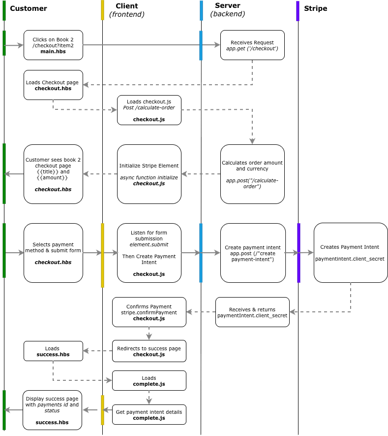

# About This Project
The objective of this project is to demonstrate the integration of Stripe Payment Element to a simple eCommerce web application. 
A successful outcome incorporates the following:
* Select a book to purchase.
* Checkout and purchase the item using Stripe Elements.
* Display a confirmation of purchase to the user with the total amount of the charge and Stripe Payment Intent ID (beginning with pi_).

### Assumptions
Working assumptions include:
* This project is a proof-of-concept (POC) to demonstrate the possibility of Stripe Payment Element integration on a eCommerce web application
* The full end-to-end experience of the checkout process will not be demonstrated in this submission (i.e. Shipping address, discounts, promotion).
* Future use cases are explored in the [Stripe Project_Joan Document](https://docs.google.com/document/d/1NKDtZG88WykOXua74mANaXGv8BU_JA0LB7Mn6zMtGsw/edit?usp=sharing)

### Approach
As this is a proof-of-concept, the objectives for the design of this project are:

* Retain as much of the existing web architecture as possible
* Configure the key sections, files, or pages for a successful integration and responses.
* Integration is done with a Stripe Sandbox
* Adapt (as much as possible) of the sample code that were documented in [Stripe's Document - Quickstart Payment Intent](https://docs.stripe.com/payments/quickstart-payment-intents)

To achieve the above outcomes:
* General configuration sequence was made from server js > frontend html > frontend js, sticking close to Stripe Document's guide
* Details on the thought process and actions taken to achieve the above objectives are documented in [Stripe Project_Joan Document](https://docs.google.com/document/d/1NKDtZG88WykOXua74mANaXGv8BU_JA0LB7Mn6zMtGsw/edit?usp=sharing)

#### Payment Integration Flow
The diagram below shows how the frontend, backend and Stripe interact through the process




# Installation

#### Step 1: 
Clone repository

```
git clone [https://github.com/Mama-Joan/Stripe-Project.git](https://github.com/Mama-Joan/Stripe-Project.git)
```
Install required Node.js pacakges
```
npm install
```

#### Step 2: 
Rename `sample.env` to `.env` and populate with your Stripe account's test API keys (retrieve from your Stripe account)

#### Step 3: 
Then run the application locally

```
npm start
```

#### Step 4: 
Navigate to [http://localhost:3000](http://localhost:3000) to view the index page.


# Configuration

<details open>
<summary>
  
### Set up the Server
For running the backend logic of managing GET and POST requests.
</summary>

#### Install the Stripe library
To download Stripe assets and dependencies that are needed to run the application
```
npm install --save stripe
```

#### Stripe Secret API
Reference Stripe Secret API key for integration

```
const stripe = require('stripe')(process.env.STRIPE_SECRET_KEY);
```

#### Calculate Order

To display the order amount in the checkout page for the customer to reference before continuing with payment using Stripe Element. 

Define Book Selection Library
Defining a database
> Code was adapted from the Get request switch statement in app.js
```
const calculateOrderAmount = (item) => {
  switch (item) {
    case '1':
      return 2300;
    case '2':
      return 2500;
    case '3':
      return 2800;
    default:
      return undefined;
```

Receive and Respond to Calculate Order Request
> Code was adapted from Stripe Documentation
```
app.post("/calculate-order", async (req, res) => {
  try {
  const item = req.query.item;
  const amount = calculateOrderAmount(item);
    res.send({ amount, currency: "sgd" });
  } catch {
    res.status(500).send({ error: "Unable to calculate the order." });
  }
});
```

#### Create Payment Intent
Payment Intent to be created in Stripe after customer submits form

Receive & Create Payment Intent
Receives post request from checkout.hbs to create Payment Intent in Stripe. Returns paymentIntent.client_secret when successful.
> Code was adapted from Stripe Documentation
```
app.post("/create-payment-intent", async (req, res) => {
  try {
    // Use the same server-owned order as /calculate-order.
    const item = req.query.item;
    // Create a PaymentIntent with the order amount and currency
    const paymentIntent = await stripe.paymentIntents.create({
      amount: calculateOrderAmount(item),
      currency: "sgd",
      // In the latest version of the API, specifying the `automatic_payment_methods` parameter is optional because Stripe enables its functionality by default.
      automatic_payment_methods: {
        enabled: true,
      },
    });

    res.send({
      clientSecret: paymentIntent.client_secret,
    });
  } catch {
    res.status(500).send({ error: "Unable to start the payment." });
  }
});
```

#### Success Route
Defining the .hbs template to render receiving a 'GET' request for 'successful payment'
> No changes were made since this came with the original repo

</details>

<details open>
<summary>
  
### Checkout Page
</summary>

#### Load Stripe.js
Stripe.js is added to main.hbs to remain PCI compliant
> Added to the head section of main.hbs

```
<script src="https://js.stripe.com/endive/stripe.js"></script>
```

#### Define payment form
Added the "payment-element" id as part of the form to load Stripe Payment Element

```
 <form id='payment-form'name="payment-form">
          <div>
            <label for="email">Email address</label>
            <input type="email" class="form-control" id="email" name="email" placeholder="you@email.com">
          </div>
          <div class="mt-20 text-center text-secondary border-placeholder">
            <div id="payment-element">
          </div>
```

</details>

<details open>
<summary>
  
### Checkout.js
</summary>

#### Create a new checkout.js 
In the original repository, there is no front-end js for powering the logic on the checkout page.
A new checkout.js is created under the /public/js folder. 

Most of code can be taken from Stripe's documentation with configurations. 

#### Publishable API Key
The publishable API key needs to be defined at the start of the page to initialize Stripe.js

```
const stripe = Stripe("pk_test_...");
```

#### Define what was the book selected
checkout.js will not know what was the item that was selected, and we need to query from the URL

```
const item = new URLSearchParams(window.location.search).get("item");
```

The functions for initialising Stripe Element and creating payment intent, needs to have the selected item defined:
> For the full code, reference the next two sections below.

```
item=${encodeURIComponent(item)}
```

#### Load Stripe Payment Element
checkout.js sends a post request to app.js for order calculation. Once successful respond is received, load Stripe Element.
The displayed payment methods on Stripe Element are configured from Stripe Dashboard. 
Automatic Payment Methods is set to 'enabled' to allow dynamic payment methods.

```
async function initialize() {
 const response = await fetch(`/calculate-order?item=${encodeURIComponent(item)}`, { method: "POST" });
  if (!response.ok) throw new Error("Unable to load the order.");
  const order = await response.json();

  const appearance = {
    theme: 'stripe',
  };
  elements = stripe.elements({
    mode: "payment",
    amount: order.amount,
    currency: order.currency,
    appearance,
  });

  const paymentElement = elements.create("payment", { layout: "accordion" });
  paymentElement.mount("#payment-element");
  setLoading(false);
}
```

Allow Stripe Elements to show dynamic payment methods to adapt to local needs 
```
automatic_payment_methods: {
        enabled: true,
```
        
#### Listen for form submission 
This is used to run the handleSubmit function upon receiving a successful form submission. 
```
document.querySelector("#payment-form").addEventListener("submit", handleSubmit);
```


#### Confirm Payment
Initiated when 'submit' button event is triggered. This is to validate that the payment form is indeed submitted.

```
async function handleSubmit(e) {
  e.preventDefault();
  if (!elements || document.querySelector("#submit").disabled) return;
  setLoading(true);

  try {
    const { error: submitError } = await elements.submit();
    if (submitError) {
      showMessage(submitError.message);
      return;
    }
```

#### Create Payment Intent
Sends the request to post a payment intent, and validates that a payment is indeed received.
Once validated, redirects to success page

> Change return_url (http://localhost:3000/success)

```
    const response = await fetch(`/create-payment-intent?item=${encodeURIComponent(item)}`, { method: "POST" });
    if (!response.ok) throw new Error("Unable to start the payment. Try again.");
    const { clientSecret } = await response.json();

    const { error } = await stripe.confirmPayment({
      elements,
      clientSecret,
      confirmParams: {
        return_url: "http://localhost:3000/success",
      },
    });

    // Successful payments redirect to the return_url. Display immediate errors.
    if (error) showMessage(error.message);
  } catch (error) {
    showMessage(error.message);
  } finally {
    setLoading(false);
  }
}
```

#### UI Helpers
> Remove codes where our frontend do not have an id for

```
// ------- UI helpers -------

function showMessage(messageText) {
  const messageContainer = document.querySelector("#payment-message");

  messageContainer.classList.remove("hidden");
  messageContainer.textContent = messageText;
}

// Show a spinner on payment submission
function setLoading(isLoading) {
  if (isLoading) {
    // Disable the button and show a spinner
    document.querySelector("#submit").disabled = true;
  } else {
    document.querySelector("#submit").disabled = false;
  }
}
```

</details>

<details open>
<summary>
  
### Complete.js
</summary>

#### Create a new complete.js 
In the original repository, there is no front-end js for powering the logic on the success page.
A new complete.js is created under the /public/js folder. Most of code can be taken from Stripe's documentation with configurations. 

#### Publishable API Key
The publishable API key needs to be defined at the start of the page to initialize Stripe.js
```
const stripe = Stripe("pk_test_...)
```

#### Fetch the payment intent status post payment submission
To fetch the payment intent status and information from the URL
```
checkStatus();

// Fetches the payment intent status after payment submission
async function checkStatus() {
  const clientSecret = new URLSearchParams(window.location.search).get(
    "payment_intent_client_secret"
  );

  if (!clientSecret) {
    setErrorState();
    return;
  }

  const { paymentIntent } = await stripe.retrievePaymentIntent(clientSecret);
  setPaymentDetails(paymentIntent);
}
```
#### Define the details that needs to be displayed on Success Page
This fetch the payment parameters that are meant to be displayed on success.hbs

```
function setPaymentDetails(paymentIntent) {
  document.querySelector("#payment-id").textContent = paymentIntent.id;
  document.querySelector("#payment-status").textContent = paymentIntent.status;
  document.querySelector("#payment-amount").textContent = `SGD ${(paymentIntent.amount / 100)}`;

}
```

#### Edits to success.hbs
Define where the payment id and payment status will be displayed

```
 <div class="mt-40 text-center">
    <div class="mt-20 text-center text-secondary border-placeholder">
       <p>Total Order Amount: <div id="payment-amount"></div></p>
      <p>Payment ID: <div id="payment-id"></div></p>
      <p>Payment Status: <div id="payment-status"></div></p>
    </div>
  </div>
```

Add complete.js script to the bottom of page

```
<script src="/js/complete.js" defer></script>

```

### APIs Used
* Payments Intent API
* Return_url API

### Future Possibilities
Once the payment integration POC is validated to be working, the following features can be added on progressively:
* [Adding the Address Element](https://docs.stripe.com/elements/address-element) to have a complete checkout process
* [Send order confirmation email, trigger shipment wofklow via Webhooks](https://docs.stripe.com/payments/quickstart-payment-intents#use-webhook)

Other administrative use cases:
* [Refunds Management](https://docs.stripe.com/api/refunds)
* [Declines Management](https://docs.stripe.com/declines)

